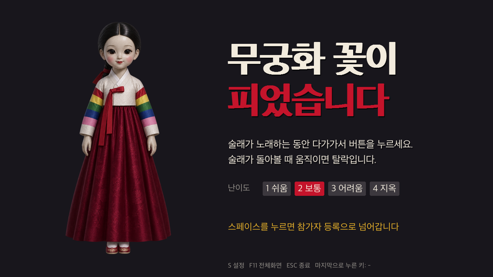

# 무궁화 꽃이 피었습니다 — 캠 챌린지

웹캠 하나로 여럿이 함께 하는 "무궁화 꽃이 피었습니다" 게임입니다.
술래 인형이 노래하는 동안 모니터 쪽으로 다가가고, 인형이 돌아볼 때 움직이면 총소리와 함께 탈락합니다.
모니터 앞의 버튼을 먼저 누르는 사람이 이깁니다.



## 개인정보: 얼굴과 몸 정보는 어디에도 저장되거나 전송되지 않습니다

이 게임은 카메라를 쓰지만 **카메라 영상과 몸 정보를 남기지 않습니다.**

- **저장하지 않습니다.** 카메라 영상은 메모리에서만 처리되고, 다음 장면이 들어오면 바로 덮어씁니다.
  사진·영상·몸의 관절 좌표를 파일로 쓰는 코드가 없습니다.
- **전송하지 않습니다.** 사람 인식은 이 컴퓨터 안에서 돌아가는 모델(`assets/models/yolo11n-pose.pt`)이 합니다.
  게임 코드에는 네트워크로 무언가를 보내는 부분이 없고, 인터넷이 끊겨 있어도 그대로 동작합니다.
- **누구인지 알아보지 않습니다.** 얼굴 인식(신원 확인)을 하지 않습니다. 게임이 쓰는 것은 화면 속 사람의 위치와
  관절 17개의 좌표뿐이며, "1번, 2번" 같은 번호는 한 판이 진행되는 동안에만 쓰고 게임을 끄면 사라집니다.
- **라이브러리의 통계 전송도 껐습니다.** 인식 라이브러리(Ultralytics)는 기본 설정에서 익명 사용 통계
  (Python·라이브러리 버전, CPU 종류 등 — 영상은 포함되지 않음)를 보냅니다. 이 게임은 시작할 때
  `YOLO_OFFLINE=1` 을 설정해 이 전송과 온라인 점검을 모두 끕니다 (`src/mugunghwa/__init__.py`).
- **디스크에 쓰는 것은 설정 하나뿐입니다.** 설정 화면에서 고른 카메라 번호·목소리·난이도·제한 시간이
  실행 폴더의 `config.json` 에 저장됩니다.
- **지인 목소리 녹음은 내 컴퓨터에만 있습니다.** `voices/` 폴더의 녹음 파일은 게임이 읽기만 하고,
  이 저장소에는 올라가지 않도록 `.gitignore` 에서 제외되어 있습니다.
  (기본 목소리 "소녀 메가폰"은 제작자 본인의 녹음을 변조한 것으로, 본인 의사에 따라 공개합니다.)

직접 확인하려면 카메라 처리는 [`camera.py`](src/mugunghwa/camera.py), 인식은 [`detector.py`](src/mugunghwa/detector.py)를 보면 됩니다.

## 놀이 방법

1. 참가자들이 카메라에서 몇 걸음 떨어져, 서로 간격을 두고 섭니다. 몸 전체가 화면에 들어오면 번호가 붙습니다.
2. 스페이스를 누르면 지금 보이는 사람들로 시작합니다. 나중에 화면에 들어온 사람은 참가자로 치지 않습니다.
3. 술래가 "무궁화 꽃이 피었습니다"를 부르는 동안에는 움직여도 됩니다. 화면 위 가사가 소리에 맞춰 켜집니다.
4. 술래가 돌아보면 "멈춰" 도장이 찍힙니다. 이때 움직이거나 화면 밖으로 나가면 탈락입니다.
5. 버튼(스페이스 또는 Enter)을 누르면 이깁니다. 버튼은 누가 눌렀는지 알 수 없어서,
   그 순간 카메라에 가장 가까이 있는 생존자를 승자로 봅니다.

제한 시간 안에 아무도 버튼을 누르지 못하면 남은 사람 모두 탈락합니다.

### 난이도

| | 쉬움 | 보통 | 어려움 | 지옥 |
|---|---|---|---|---|
| 움직임 판정 기준 (키 대비) | 6% | 3.5% | 2.5% | 1.8% |
| 돌아본 뒤 판정까지 여유 | 0.7초 | 0.45초 | 0.35초 | 0.28초 |
| 노래를 끊고 갑자기 돌아보기 | 없음 | 20% | 30% | 40% |
| 돌아선 척하다 다시 돌아보기 | 없음 | 15% | 25% | 35% |

보통부터는 판이 길어질수록 노래가 빨라집니다.

### 키

| 키 | 동작 |
|---|---|
| 스페이스 | 메뉴에서 다음으로, 게임 중에는 승리 버튼 |
| Enter | 게임 중 승리 버튼 |
| S | 설정 화면 (제목 화면에서) |
| 1 2 3 4 | 난이도 |
| + / - | 움직임 판정 기준을 즉석에서 조정 |
| D | 디버그 표시 (사람별 움직임 점수, 인식 속도) |
| F11 | 전체 화면 |
| ESC | 설정 닫기, 게임 종료 |

키는 자판 언어와 상관없이 물리 위치로 읽기 때문에 한글 입력 상태에서도 동작합니다.
대형 스위치를 쓴다면 제목 화면 아래 "마지막으로 누른 키"에서 스위치가 보내는 키를 확인할 수 있습니다.

## 설치와 실행

Python 3.11 또는 3.12가 필요합니다.

```bash
python3.12 -m venv .venv
.venv/bin/pip install -e '.[dev]'
.venv/bin/python -m mugunghwa
```

Windows에서는 `.venv\Scripts\python -m mugunghwa` 로 실행합니다.

기본 구호 목소리는 **"소녀 메가폰"** 입니다 (제작자 목소리를 메가폰에서 나오는 소녀 목소리로 변조).
다른 목소리를 쓰고 싶으면:

- 직접 녹음: `voices/<이름>/chant.wav` 에 "무궁화 꽃이 피었습니다" 녹음을 넣습니다 (아래 "목소리 추가하기").
- macOS 기계음 만들기: `.venv/bin/python tools/make_sounds.py` 를 실행하면 macOS 내장 음성으로
  `assets/voices/기계음/chant.wav` 를 만듭니다. macOS 내장 음성은 Apple 약관상 개인적인 용도로만 쓰는 것이 안전해서
  저장소와 배포본에는 넣지 않습니다.
macOS에서 처음 실행하면 카메라 권한을 물어봅니다.

테스트는 `.venv/bin/pytest -q` 로 돌립니다.

## 설정

제목 화면에서 **S** 를 누르면 설정 화면이 열립니다. 닫을 때 `config.json` 에 저장됩니다.

- **카메라**: 번호를 바꾸면 왼쪽에 그 카메라 화면이 바로 나옵니다. 맥에 아이폰이 연결되어 있으면 0번이 아이폰일 수 있습니다.
- **술래 목소리**: 기본은 소녀 메가폰입니다. `voices/` 폴더와 `assets/voices/` 에 있는 목소리 중에서 고릅니다. 아래 방법으로 직접 녹음한 목소리를 추가할 수 있습니다.
- **난이도**, **제한 시간**

그 밖의 값(판정 세부값, 버튼 키 등)은 `config.example.json` 을 `config.json` 으로 복사해 고칠 수 있습니다.

### 목소리 추가하기

`voices/` 폴더에 사람마다 폴더를 만들고 "무궁화 꽃이 피었습니다" 녹음을 `chant.wav` 로 넣으면 목소리 목록에 나타납니다.

```
voices/
  철수/chant.wav
  영희/chant.wav
```

녹음 앞뒤의 무음은 자동으로 잘라내고, 말이 시작하고 끝나는 지점을 찾아 화면 가사를 맞춥니다.
목소리가 둘 이상이면 "무작위"를 골라 판마다 다른 목소리로 들을 수 있습니다.
자세한 내용은 [`voices/README.md`](voices/README.md)에 있습니다.

## 구조

카메라 스레드 → 인식 스레드(YOLO11n-pose + ByteTrack) → pygame 메인 루프로 이어지며,
스레드 사이에는 가장 최신 값 하나만 주고받습니다. 움직임 판정은 관절별 이동량을 키로 나눠
카메라와의 거리와 상관없이 같은 기준으로 봅니다.

설계 결정과 그 이유는 [`docs/adr/`](docs/adr/README.md)에 기록되어 있습니다.

## 그림과 소리

규칙은 누구나 아는 전통 놀이에서 가져왔지만, 드라마 속 인형·음성·음악·로고는 쓰지 않습니다.
술래 인형은 색동 한복을 입은 자체 디자인이고, 효과음은 코드로 합성했습니다. 기본 구호는 제작자 본인의 녹음을 `tools/voicefx`(NAudio)로 변조한 것입니다.
출처는 [`assets/CREDITS.md`](assets/CREDITS.md)에 있습니다.

## 라이선스

사람 인식에 쓰는 [Ultralytics YOLO](https://github.com/ultralytics/ultralytics)는 AGPL-3.0 라이선스입니다.
이 게임을 배포할 때는 소스 코드를 함께 공개해야 합니다. 이 프로젝트 자체의 라이선스 파일은 아직 정하지 않았습니다.
